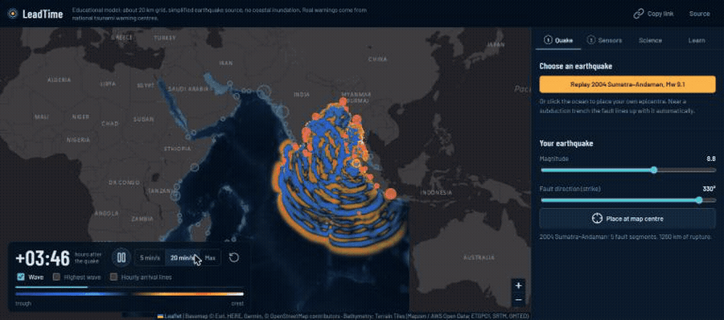
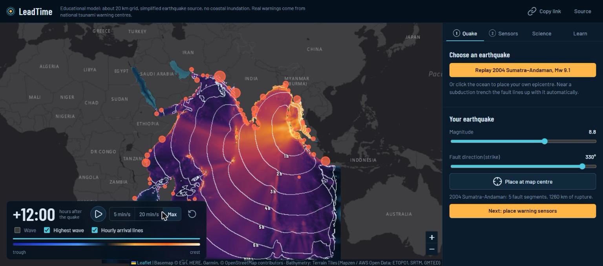
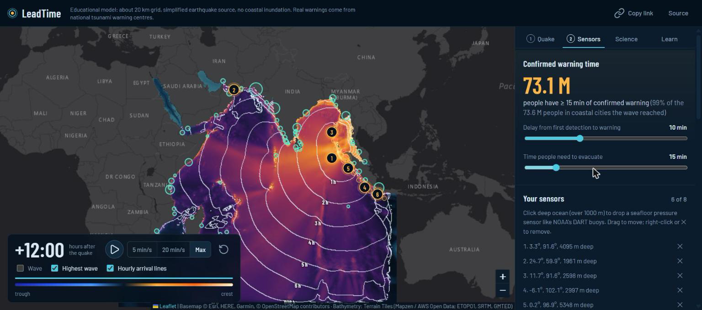
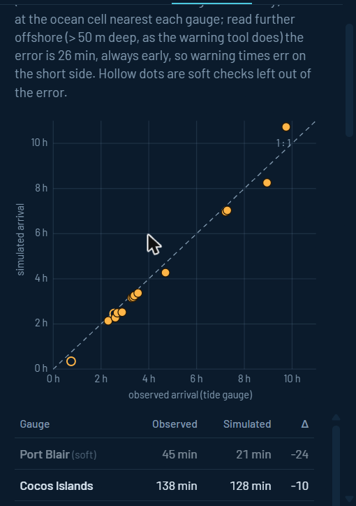

# LeadTime: every minute of tsunami warning, simulated

**▶ Live demo: https://leadtime-liard.vercel.app** · Video: _YouTube link added at submission_ (source in [`film/`](film/)) · Built for the STEM Innovation Challenge 2026 (Devpost)



Pick an undersea earthquake, real or hypothetical, and watch its tsunami cross the real Indian Ocean floor. The physics runs live in your browser. Then answer the question warning-system designers face: **where should the sensors go so the most people get enough time to run?**

> Educational model: about 20 km grid, simplified earthquake source, no coastal inundation. Real warnings come from national tsunami warning centres.

## The problem

On 26 December 2004 a magnitude 9.1 earthquake off Sumatra sent a tsunami across the Indian Ocean. It killed more than 227,000 people (Wikipedia gives 227,898; USGS gives more than 283,100). The wave took 2 h 53 min to reach Colombo's tide gauge (Merrifield et al. 2005), yet **there was no tsunami warning system in the Indian Ocean** (Merrifield et al. 2005). India's warning centre opened in October 2007 and the regional service went live in October 2011 (INCOIS; IOC-UNESCO).

Warning networks now exist, but *how sensor placement turns into minutes of warning for real people* is invisible to students and coastal communities. Professional tsunami models need specialist software and training.

## What it does

- **Real-bathymetry tsunami simulation** for any earthquake: replay 2004 from its 5 published fault segments, or click the ocean and choose a magnitude.
- **Energy and arrival maps:** the highest wave at every point (the "energy beams") and hourly arrival-time lines.
- **65 coastal cities** with populations, wave arrival time and offshore height.
- **Be the warning engineer:** drop up to 8 deep-ocean pressure sensors (like NOAA's DART buoys). Each city's **confirmed warning time** updates instantly: arrival − (first detection + processing delay). Cities short of the evacuation time turn red.
- **Optimizer:** simulates 15 hypothetical Mw 8.8 earthquakes along the Sunda, Andaman and Makran trenches in parallel Web Workers, then places sensors greedily where they warn the most people. It shows the diminishing returns and scores the real buoy network the same way.
- **Science tab:** re-runs the physics test suite live and checks the 2004 simulation against 15 tide gauges.
- **Learn cards:** why tsunamis are as fast as jets, how the seafloor focuses them, warning vs confirmation, and the *smong* story of Simeulue, where only 7 of 78,128 people died because of an oral tradition (McAdoo et al. 2006).
- Share links, keyboard alternatives, colour-blind-safe palettes, reduced motion, and a phone layout.

| Highest wave + hourly arrival lines | Optimized sensors |
|---|---|
|  |  |

**What the optimizer found** (default settings: 10 min processing, 15 min to evacuate; numbers from the live app). Six sensors warn on average **61.5 M** of the 62.1 M people in coastal cities reached, per quake. The gains are 53.0 M, 7.1 M, 943 k, 438 k, 69 k and 0 for sensors 1 to 6: the first two sensors do almost all the work. The 13 real stations we have positions for score 58.7 M under the same metric. Real networks also weigh cost, maintenance, false alarms and politics, and Indonesia's buoys are missing from our data, so this is a teaching comparison, not a verdict. **Near-field cities such as Banda Aceh (wave at 0:21 in our model) stay red whatever you do:** there, only education and natural warning signs help.

## How it works

1. **Seafloor:** 16 Terrarium elevation tiles are decoded in the browser (`h = R·256 + G + B/256 − 32768`) and averaged to a 512 × 512 Mercator grid (~20 km cells). Cell size shrinks with latitude; Mercator cells stay square, which keeps the solver simple.
2. **Source:** fault length, width and slip from magnitude (Strasser et al. 2010) and seismic moment; the sea surface copies the seafloor's uplift (trench side) and subsidence (land side) as a dipole.
3. **Solver:** a "virtual pipe" shallow-water model. Water columns are joined by pipes; `dQ/dt = g·h·Δη` and `dη/dt = (ΣQin − ΣQout)/s²` give waves at `c = √(g·h)`. It adds a positivity limiter, an adaptive time step, an absorbing sponge and shallow-water friction, and runs in a Web Worker at roughly 1000× real time.
4. **Warning metric and optimizer:** `lead = t_city − (t_first_sensor + T_proc)`; greedy placement over 3,350 deep-water candidate sites and 15 scenarios.

Details: [docs/ARCHITECTURE.md](docs/ARCHITECTURE.md) · validation: [docs/VALIDATION.md](docs/VALIDATION.md). The three files to read are `src/solver.ts`, `src/source.ts` and `src/warning.ts`, and the physics is commented line by line.

## Validation



- **Physics tests (6/6 pass):** mass conserved to 1e-15, an ocean at rest stays exactly still, wave speed 197.6 vs 198.1 m/s (0.3%), exact symmetry, shelf travel time within 2.4% of ray theory, and realistic Mw 9.1 fault size.
- **2004 tide gauges:** mean absolute error **20 min over 13 gauges**, with simulated waves on average 11 min early (26 min, always early, when read further offshore as the warning tool does). We report this as measured: a 20 km grid cannot resolve harbours and shallow shelves. See [VALIDATION.md](docs/VALIDATION.md).

## Tech stack

TypeScript, Vite, Leaflet, Web Workers, Canvas 2D, SVG, vitest. No backend, no accounts, no AI APIs: everything runs in the browser.

## Data sources and attributions

| Data | Source |
|---|---|
| Bathymetry / topography | Terrain Tiles (Mapzen / AWS Open Data; ETOPO1, SRTM, GMTED and others) |
| Basemap | Esri World Dark Gray (Esri, HERE, Garmin, © OpenStreetMap contributors) |
| 2004 rupture | Grilli et al. 2007, J. Waterway Port Coastal Ocean Eng. 133(6), Table 1; epicentre and magnitude from USGS |
| Magnitude scaling | Strasser, Arango & Bommer 2010, SRL 81(6) (coefficients via Salah et al., arXiv:2010.01284) |
| Tide-gauge arrivals | Merrifield et al. 2005 (GRL); Nagarajan et al. 2006 and Tsuji et al. 2006 (Earth Planets Space); Bilham et al. 2005; coordinates from UHSLC / PSMSL |
| Trenches | Bird 2003, PB2002 plate boundaries |
| Tsunami buoys | NOAA NDBC station list; INCOIS sea-level network report (2025) |
| Coastal cities | National censuses, via Wikipedia (each city's URL is in `src/data/cities.json`) |
| Facts in the Learn cards | NOAA NWS, tsunami.gov FAQ, INCOIS, IOC-UNESCO, McAdoo et al. 2006 |

Every number shown in the app traces to `src/data/*.json`, which stores a source and URL for each value. Libraries: Leaflet (BSD-2-Clause), Barlow and Barlow Condensed fonts (SIL OFL 1.1, via Fontsource), Lucide icons (ISC).

## Limitations

- ~20 km grid: harbours, bays and narrow shelves are not resolved, so coastal arrival times are approximate.
- Simplified dipole source, not the full Okada (1985) solution; uniform slip per segment.
- No inundation or run-up, Coriolis force, dispersion or tides.
- Populations are approximate and mix census years and area definitions.
- The optimizer scenario library is hypothetical (Mw 8.8 every ~300 km of trench) and runs on a coarser 256² grid.
- It is not an operational forecast.

## Run locally

```bash
npm i
npm run dev        # http://localhost:5173
npx vitest run     # 13 tests: physics, geometry, warning time, optimizer
npm run build
```

## AI-assisted development disclosure

This project was built during the hackathon with AI-assisted development (Claude Code), which helped with scaffolding, the solver and optimizer implementation, the UI and documentation drafts. The team reviewed all code, ran and checked every validation test, and can explain each component. The data in `data/` was collected and sourced at the start of the hackathon. [BUILDLOG.md](BUILDLOG.md) records what was built when and the problems we hit.

## Team

_Team members and roles: to be completed before submission._

## License

MIT, see [LICENSE](LICENSE).
