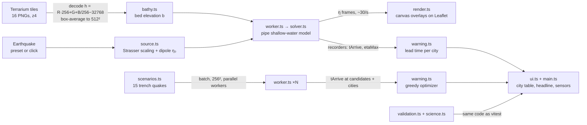

# Architecture

LeadTime is a static site: TypeScript, Vite and Leaflet, with no backend. All physics runs in the browser, mostly in Web Workers.



## Files

| File | Job |
|---|---|
| `src/geo.ts` | Slippy-tile math, per-row Mercator cell size, lat/lon ↔ cell |
| `src/bathy.ts` | Fetch and decode tiles, average to the grid, flood-fill so only the connected ocean is wet |
| `src/source.ts` | Earthquake → initial sea surface (Strasser 2010 scaling, dipole, Grilli 2004 segments) |
| `src/solver.ts` | Pure shallow-water solver: fluxes, limiter, continuity, sponge, friction, recorders |
| `src/worker.ts` | Live playback (streams η) and batch runs (returns arrival times at chosen cells) |
| `src/render.ts` | Leaflet map; canvas overlays for depth, wave, highest wave and isochrones |
| `src/warning.ts` | Coast snapping, lead time, greedy optimizer, coverage scoring (pure, unit-tested) |
| `src/scenarios.ts` | 2004 preset, click-to-place quakes, trench-aligned strike, synthetic library |
| `src/ui.ts` | City table, headline, gain chart, aria-live summary |
| `src/science.ts`, `src/validation.ts` | Physics checks (shared with vitest) and the 2004 tide-gauge comparison |
| `src/main.ts` | Wiring: state, tabs, sensors, optimizer runs, share links, Learn cards |

## Equations

**Grid.** A 4 × 4 window of zoom-4 tiles (22.5°E–112.5°E, 41°S–41°N) sampled to N × N cells. The cell side in row j is

```
s_j = (40075016.686 / (256·2^z)) · (1024/N) · cos(lat_j)      ≈ 19.6 km at the equator for N = 512
```

**Source.** `log10 L = −2.477 + 0.585·Mw`, `log10 W = −0.882 + 0.351·Mw`, `M0 = 10^(1.5·Mw + 9.1)`, `D = M0/(μ·L·W)` with μ = 3×10¹⁰ Pa. In fault coordinates (u along strike, v across strike toward the trench):

```
η0 = 0.3·D · taper(u, L) · [ G(v − W/4, W/4) − 0.6·G(v + W/4, W/4) ]
```

**Solver.** One signed volume flux Q per cell face (m³/s), η = sea-surface displacement, h = water depth:

```
Q ← Q + dt · g · h_upwind · (η_i − η_k)               pipe momentum (A/ℓ = h for square cells)
Q ← Q / (1 + dt·g·n²·|Q| / (s·h^(7/3)))                Manning friction, only where h < 200 m
K = min(1, d·s² / (ΣQ_out·dt))                         positivity limiter on outgoing faces
η ← η + dt · (ΣQ_in − ΣQ_out) / s²                     continuity (conserves Σ η·s² exactly)
dt = 0.4 · min(s) / √(g·h_max)                         CFL time step, ≈ 20 s
```

A 20-cell sponge at the domain edge damps η and Q quadratically so waves leave without reflecting. Land (b ≥ 0) is a wall. The recorders keep, per cell, the first time |η| > 5 cm (`tArrive`) and the highest crest (`etaMax`).

**Warning.** For city c and sensors B: `lead = tArrive(c) − (min_b tArrive(b) + T_proc)`; warned if `lead ≥ T_evac`. Cities are read at the nearest ocean cell deeper than 50 m; sensors must sit deeper than 1000 m.

**Optimizer.** Greedy: for k = 1..K add the candidate maximising `Σ_s Σ_c pop_c · [lead_s,c ≥ T_evac]` (ties broken by people-minutes). Candidates are every 3rd cell of the 256² library grid deeper than 1000 m, outside the sponge. Partly sheltered cities (Jakarta, Yangon, Bandar Abbas, Malacca) get zero weight.

## Design decisions

- **Signed face fluxes instead of two clamped one-way pipes.** It is the same pipe idea, but it reduces exactly to the classic staggered long-wave scheme and adds no spurious kick when the flow reverses.
- **Local copies of the 16 tiles** in `public/tiles`, so the demo never depends on S3 at runtime (S3 is the fallback).
- **Coarser 256² grid for the optimizer library:** 8× less work per quake. 15 quakes run in 18–30 s in 4 parallel workers.
- **Phones use N = 256** for the live run as well.
- **No UI framework.** Plain DOM keeps the bundle small (~77 kB gzipped JS, mostly Leaflet and the sourced data) and the code easy to follow.
