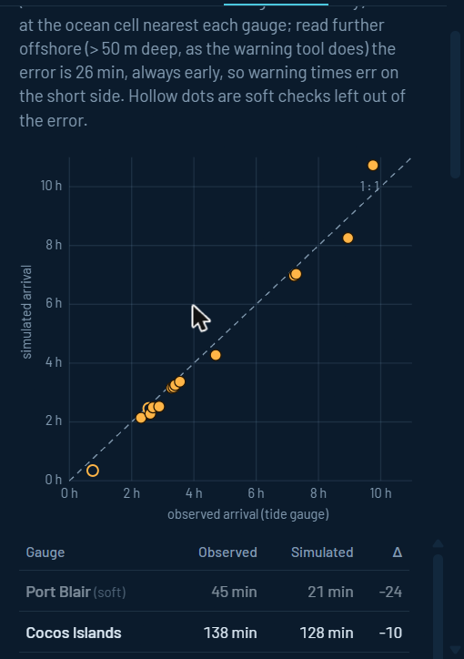

# Validation

Everything here can be re-run in the app: **Science tab → "Check against 2004 tide gauges"** and **"Run validation"**. The physics checks are also the automated test suite (`npx vitest run`, `test/solver.test.ts`), and both use the same code (`src/validation.ts`).

## 1. Physics checks (solver and source)

| # | Check | Measured | Expected | Result |
|---|---|---|---|---|
| 1 | Mass conservation: closed basin with an uneven floor and an island, Gaussian hump, 2000 steps | \|ΔV\|/V = 1.3e-15 | < 1e-6 | PASS |
| 2 | Ocean at rest: rough "real-like" seafloor, η = 0, 1000 steps | max \|η\| = 0 m | < 1e-6 m | PASS |
| 3 | Wave speed: 1-D channel, flat 4000 m floor, crest timed between two gauges 2000 km apart | 197.6 m/s | √(g·h) = 198.1 m/s ± 5% | PASS (0.27% error) |
| 4 | Radial symmetry: flat basin, centred hump, 300 steps; mirror and transpose differences | 0 m | < 1e-5 m | PASS |
| 5 | Shoaling: deep ocean → slope → 100 m shelf; crest travel time between a deep and a shelf gauge | 120.6 min | ∫dx/√(gh) = 117.8 min ± 10% | PASS (2.4% error) |
| 6 | Source scaling at Mw 9.1 (Strasser et al. 2010) | L 700 km, W 205 km, slip 13 m; uplift and subsidence lobes | L 600–800, W 170–240 km, slip 8–20 m, both lobes | PASS |

Notes:
- Check 3 measures the *crest*. A threshold-based "first arrival" of a smooth hump is earlier than its crest by roughly the hump's half-width ÷ c, plus a small numerical precursor (about 5 min over 2000 km for a source only 1.6 cells wide, measured during the build). That precursor is one reason the 2004 arrivals below come out early.
- Check 5 includes the shallow-water Manning friction used in the app.

## 2. The 2004 Sumatra–Andaman tsunami vs tide gauges

**Setup:** the 5-segment Grilli et al. (2007) rupture, each segment triggered at its published time; 512² grid (≈ 20 km cells); arrival = first time |η| > 5 cm; each gauge is read at the ocean cell nearest to it.

**Result: mean absolute error 20 min over 13 tide gauges; on average the simulated wave arrives 11 min early.** Port Blair (possibly land subsidence, unpublished) and Kuraburi (gauge clock about 12 min off) are soft checks: shown, but left out of the error.

| Gauge | Observed | Simulated | Δ (min) |
|---|---|---|---|
| Port Blair (soft) | 45 min | 21 min | −24 |
| Cocos Islands | 138 min | 128 min | −10 |
| Kuraburi (soft) | 153 min | 148 min | −5 |
| Chennai | 156 min | 137 min | −20 |
| Visakhapatnam | 161 min | 150 min | −12 |
| Colombo | 173 min | 151 min | −22 |
| Malé (Hulhulé) | 197 min | 189 min | −8 |
| Gan | 201 min | 191 min | −10 |
| Tuticorin | 204 min | 195 min | −9 |
| Hanimaadhoo | 213 min | 202 min | −11 |
| Kochi | 282 min | 256 min | −26 |
| Salalah | 433 min | 418 min | −15 |
| Pointe La Rue | 437 min | 422 min | −15 |
| Lamu | 537 min | 495 min | −42 |
| Zanzibar | 585 min | 644 min | +59 |

**If we read the wave further offshore** (nearest cell deeper than 50 m, the rule the warning tool uses for cities) the error is **26 min and always early**. That is why warning times in the app err on the short (safe) side.

**Why the errors:**
1. A 20 km grid cannot resolve harbours, lagoons and the last tens of kilometres of shallow shelf where real waves slow down most (Kochi, Lamu, Chennai). The Zanzibar gauge sits in a channel behind Zanzibar Island that the grid barely resolves, and is the only late one.
2. Deep-water paths are still about 5% early (Cocos, Maldives). Linear long-wave models without dispersion, elastic-earth and seawater-compressibility effects are known to run slightly fast; our source is also smooth and wide, so its leading edge sits ahead of the real one.
3. The first-arrival threshold matters: 1 cm instead of 5 cm makes arrivals 4–7 min earlier still.

We report these numbers as measured; nothing was tuned to fit the observations except choosing the 5 cm threshold from the plan's suggested 1–5 cm range.

**Sources:** Merrifield, M. A., et al. (2005), *Tide gauge observations of the Indian Ocean tsunami, December 26, 2004*, GRL 32, L09603. Nagarajan, B., et al. (2006), *Earth Planets Space* 58, 211–215. Tsuji, Y., et al. (2006), *Earth Planets Space* 58, 223–232. Bilham, R., et al. (2005), SRL (author draft). Gauge coordinates from the UHSLC and PSMSL station lists. Rupture: Grilli, S. T., et al. (2007), *J. Waterway Port Coastal Ocean Eng.* 133(6), Table 1. Full citations and URLs in `src/data/obs2004.json` and `src/data/physics.json`.

